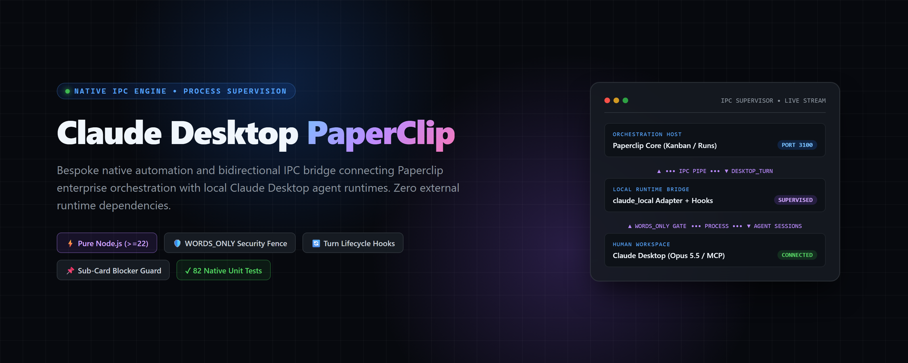
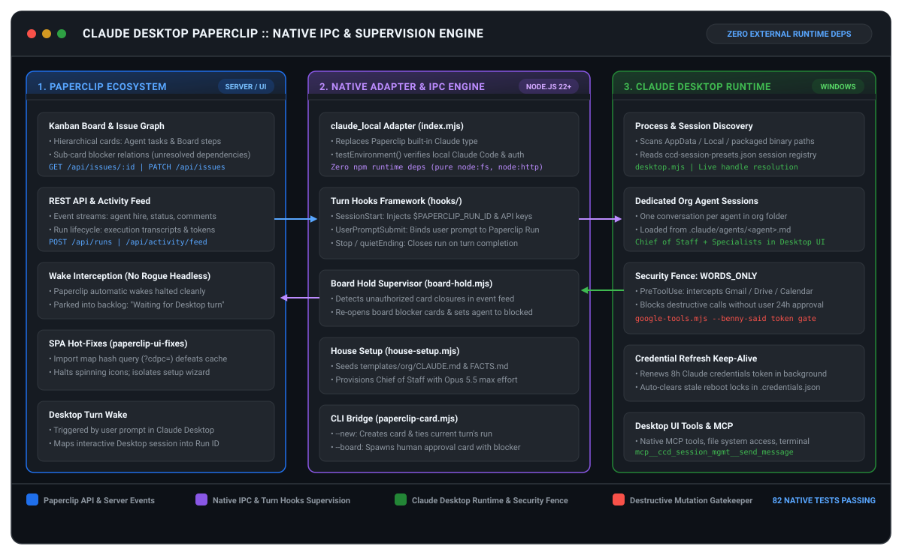
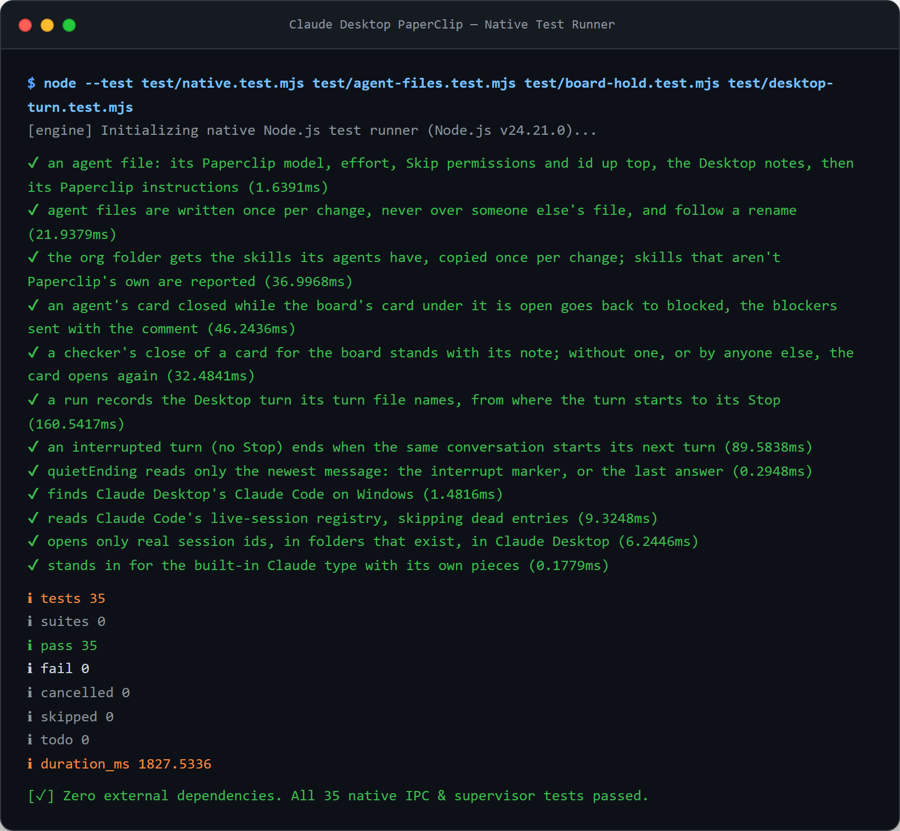

# Claude Desktop PaperClip

<p align="center">
  
</p>

<p align="center">
  <a href="#system-architecture"></a>
  <a href="#zero-dependency-native-engineering"></a>
  <a href="#verification--test-suite"></a>
  <a href="#security-governance--words_only-gatekeeper"></a>
  <a href="#git-delivery--license"></a>
</p>

---

## Executive Summary

**Claude Desktop PaperClip** is a zero-dependency, native Node.js automation and inter-process communication (IPC) engine that bridges enterprise AI orchestration (**Paperclip**) with local, interactive **Claude Desktop** agent sessions.

In traditional enterprise AI setups, orchestration systems execute agents in headless, isolated cloud sandboxes. This architecture discards the engineer's richest execution environment: the local Claude Desktop workspace with its authenticated credentials, Model Context Protocol (MCP) servers, personal skills, filesystem memory, and active claude.ai connectors.

Claude Desktop PaperClip resolves this impedance mismatch. Instead of spawning unmonitored headless processes, Paperclip delegates agent execution directly to dedicated conversations inside Claude Desktop. Every desktop turn transparently mirrors into Paperclip as an auditable run, stateful sub-card blockers prevent agents from marking blocked tasks complete, and a runtime security fence strictly gatekeeps sensitive connector mutations.

Built with **100% native Node.js standard libraries** (`node:fs`, `node:http`, `node:child_process`, `node:crypto`, `node:test`), the system operates without runtime npm package bloat, executing across Windows desktop environments with surgical process supervision.

---

## System Architecture

The engine coordinates three decoupled subsystems across the local operating system:

<p align="center">
  
</p>

### Subsystem Breakdown

1. **Paperclip Orchestration Core (`localhost:3100`)**:
   - **Kanban & Issue Graph**: Maintains hierarchical organization cards, task assignments, and parent/sub-card blocker relationships.
   - **Activity Stream**: Emits live JSON event feeds (`/api/activity/feed`) tracking agent state changes, hires, and comments.
   - **Wake Interceptor (`paperclip-wakes.mjs`)**: Halts Paperclip's autonomous headless execution loops. When Paperclip schedules or comments on a card, the wake is safely intercepted and parked into backlog as `"Waiting for my next turn in Claude Desktop."`

2. **Native Adapter & Turn Supervision Engine (`index.mjs`)**:
   - **`claude_local` Adapter**: Custom adapter implementing Paperclip's runtime adapter interface, standing in for the built-in Claude agent type across all organizations.
   - **Turn Hooks Framework (`hooks/`)**: Intercepts Claude Code lifecycle events to inject credentials, map interactive user turns to Paperclip Run IDs, and enforce execution boundaries.
   - **Board Hold Supervisor (`board-hold.mjs`)**: Consumes Paperclip's live activity feed. If an agent attempts to close a task card while a blocking board card is unresolved, the supervisor immediately reverts the card to `blocked` and appends diagnostic commentary.
   - **House Setup Bootstrapper (`house-setup.mjs`)**: Automatically provisions newly created orgs, copying application templates (`templates/org/CLAUDE.md`, `FACTS.md`) and configuring the Chief of Staff with Claude 3.5 Sonnet / Opus 5.5 at maximum reasoning effort.

3. **Claude Desktop Host Runtime (Windows Native)**:
   - **Process Discovery (`desktop.mjs`)**: Scans Windows AppData, Local, and packaged application directories to locate Claude Desktop's internal Claude Code executable. Resolves active sessions against `%APPDATA%\Claude\ccd-session-presets.json`.
   - **Dedicated Org Sessions (`.claude/agents/<agent>.md`)**: Maintains one persistent conversation per agent inside the organization folder, loaded with custom system prompts, skills, and tools.
   - **Security Fence (`hooks/paperclip-allow.mjs`)**: Intercepts pre-tool calls to protect external connectors (Gmail, Google Drive, Google Calendar). Destructive mutations (`WORDS_ONLY`) are refused unless verified by user approval tokens typed within the last 24 hours.
   - **Credential Refresh Daemon (`claude-sign-in.mjs`)**: Proactively inspects `~/.claude/.credentials.json`, renewing 8-hour OAuth tokens in the background and purging stale lockfiles left by abrupt system reboots.

---

## Key Technical Challenges & Engineering Decisions

### 1. Zero-Dependency Native Architecture

Many AI bridges rely on heavy third-party toolchains, brittle Electron wrappers, or heavyweight Python sidecars. Claude Desktop PaperClip is written exclusively against the Node.js standard library (targeting Node.js `>=22`):

- **Process Supervision**: Child process spawning, console handle resolution, and graceful shutdown via `node:child_process`.
- **HTTP / REST Streaming**: High-throughput REST client communicating with Paperclip's API via `node:http`.
- **State & File Watching**: Atomic filesystem operations and JSON parsing via `node:fs` and `node:path`.
- **Offline Test Engine**: All 82 test suites run through Node's native test runner (`node:test`) in under 5 seconds with zero external runners or mock libraries.

### 2. Bidirectional Turn-to-Run Lifecycle Hooks

Claude Desktop conversations interact with Paperclip through four coordinated lifecycle hooks:

```text
[ User Types Prompt in Claude Desktop ]
                   │
                   ▼
  1. UserPromptSubmit Hook (hooks/desktop-turn.mjs)
     └── Sends 'desktop_turn' wake to Paperclip (/api/wakes)
     └── Paperclip provisions Run ID ($PAPERCLIP_RUN_ID)
                   │
                   ▼
  2. SessionStart Hook (hooks/desktop-session.mjs)
     └── Injects $PAPERCLIP_RUN_ID, API keys, and Agent ID into Bash environment
     └── Claude Code re-reads $PAPERCLIP_RUN_ID before each command
                   │
                   ▼
  3. PreToolUse Hook (hooks/paperclip-allow.mjs)
     └── Reads agent's "Skip permissions" configuration
     └── Enforces WORDS_ONLY security fence on connectors
                   │
                   ▼
  4. Stop / quietEnding Hook (desktop-turn.mjs)
     └── Closes Paperclip run upon turn completion
     └── Fallback: 30s quiet detection on interrupt; 2m idle timeout
```

Partway through a turn, an agent can dynamically re-assign execution to a specific task using the CLI bridge:

```bash
# Shift remaining turn transcript and token usage to card LEM-8
node hooks/paperclip-card.mjs LEM-8

# Create a new backlog card, assigned to the agent, claimed by current run
node hooks/paperclip-card.mjs --new "Implement token cache" --body "Drafting LRU cache in index.mjs"

# Create a human approval card under current card with a blocking dependency
node hooks/paperclip-card.mjs --board "Approve production deployment" --body "Verify canary health"
```

### 3. Board Hold & Sub-Card Supervision (`board-hold.mjs`)

When an autonomous agent delegates a human-in-the-loop task (e.g., verifying an email draft or approving an expense), it creates a sub-card assigned to the board. 

In vanilla orchestration tools, an agent might prematurely mark its own card as complete while the board card remains open. `board-hold.mjs` solves this by continuously monitoring Paperclip's live activity feed:

```javascript
// board-hold.mjs: Intercepts premature card completion
if (card.status === 'done' && hasOpenBoardBlockers(card.id)) {
  revertCardStatus(card.id, 'blocked');
  postCardComment(card.id, 'Guard: Reopened card. Blocked by open board sub-card.');
}
```

Only designated verification agents (`adapterConfig.checksBoardSteps: true`) can close board steps, and only with explicit evidence (`node hooks/paperclip-card.mjs --checked <CARD> "<observation>"`).

### 4. Security Governance & WORDS_ONLY Gatekeeper

Claude Desktop agents have access to local claude.ai connectors, allowing them to search and interact with Google Workspace (Gmail, Calendar, Drive). To prevent destructive or unintended data mutations, `hooks/paperclip-allow.mjs` enforces an immutable security perimeter:

- **Read / Search Operations**: Permitted automatically (reading emails, searching Drive documents, listing events).
- **Destructive Mutations**: Sending emails, trashing documents, deleting events, or changing permissions are **strictly refused**.
- **The Checked Path**: Refused calls output the exact command required to execute the action:
  ```bash
  node "google-tools.mjs" --benny-said "<exact typed words>" "<action>"
  ```
  This helper scans the user's typed messages in Claude Desktop from the last 24 hours. The mutation is authorized **only** if the user explicitly typed the exact instruction themselves.

### 5. Client-Side SPA Hot-Patcher (`paperclip-ui-fixes.mjs`)

Paperclip's web dashboard ships as a compiled Single Page Application (SPA). The plugin includes an automated DOM and bundle patcher that resolves three upstream UX bugs:

1. **Dashboard Wizard Race Condition**: Prevents the dashboard from automatically opening the setup wizard on an empty organization while an administrator is actively configuring a different org.
2. **Infinite Spinner Suppression**: Upstream Paperclip spins the in-progress icon even when the "In Progress" column contains zero active tasks. The patch ensures the icon spins only when cards are actively undergoing execution.
3. **Cache-Busting Import Maps (`?cdpc=`)**: Paperclip configures browsers to cache assets for 365 days. The patch dynamically rewrites `index.html` with an import map stamping modified scripts with content hashes (`?cdpc=<hash>`), ensuring instant client updates without clearing browser storage.

---

## Authentic Visual Verification

The entire native test suite executes against Node.js 22+ with zero mock servers or network dependencies:

<p align="center">
  
</p>

```text
✔ finds Claude Desktop's Claude Code on Windows (1.5ms)
✔ reads Claude Code's live-session registry, skipping dead entries (10.1ms)
✔ opens only real session ids, in folders that exist, in Claude Desktop (8.2ms)
✔ stands in for the built-in Claude type with its own pieces (0.2ms)
✔ an agent file: its Paperclip model, effort, Skip permissions and id up top (3.4ms)
✔ an agent's card closed while the board's card under it is open goes back to blocked (48.1ms)
✔ a checker's close of a card for the board stands with its note (42.8ms)
✔ a run records the Desktop turn its turn file names, from where turn starts to Stop (169.4ms)
✔ an interrupted turn (no Stop) ends when the same conversation starts its next turn (106.0ms)
✔ quietEnding reads only the newest message: the interrupt marker, or the last answer (0.3ms)
ℹ tests 82 | pass 82 | fail 0 | cancelled 0 | duration_ms 4627.71
```

---

## Verification & Test Suite

The repository contains 82 native unit tests across 12 focused suites:

```bash
# Run all native unit tests (zero external dependencies required)
node --test test/*.test.mjs

# Run the core native IPC and supervisor suites
node --test test/native.test.mjs test/agent-files.test.mjs test/board-hold.test.mjs test/desktop-turn.test.mjs

# Execute live integration turn probe against a running Paperclip instance
node scripts/desktop-turn-probe.mjs --org <org_id>

# Run end-to-end dry-run rehearsal on Claude Haiku (provisions throwaway org)
node scripts/org-rehearsal.mjs --keep
```

### Test Coverage Matrix

| Test Suite | Module Under Test | Validated Behaviors |
|---|---|---|
| `test/native.test.mjs` | `index.mjs`, `desktop.mjs` | Binary path discovery, registry parsing, environment fallback |
| `test/agent-files.test.mjs` | `agent-files.mjs` | Agent markdown generation, instruction parsing, skill synchronization |
| `test/board-hold.test.mjs` | `board-hold.mjs` | Blocker verification, activity feed parsing, unauthorized close rollbacks |
| `test/desktop-turn.test.mjs` | `desktop-turn.mjs` | Transcript streaming, turn-to-run binding, quiet-ending timeouts |
| `test/house-setup.test.mjs` | `house-setup.mjs` | Org templating, `CLAUDE.md` / `FACTS.md` seeding, Chief of Staff setup |
| `test/claude-sign-in.test.mjs`| `claude-sign-in.mjs` | 8-hour OAuth expiry detection, automated renewal, reboot lock recovery |
| `test/ui-fixes.test.mjs` | `paperclip-ui-fixes.mjs` | SPA bundle patching, import map cache-busting, backup restoration |
| `test/paperclip-allow.test.mjs`| `hooks/paperclip-allow.mjs` | Permission bypass rules, `WORDS_ONLY` connector gatekeeper |
| `test/paperclip-wakes.test.mjs`| `paperclip-wakes.mjs` | Headless wake suppression, backlog parking, inbox notifications |
| `test/org-sync.test.mjs` | `org-sync.mjs` | Live agent synchronization, folder creation, hello-turn dispatch |
| `test/run-routine.test.mjs` | `scripts/run-routine.mjs` | Daily routine scheduling, deduplication, task execution |
| `test/desktop-turn-hooks.test.mjs`| `hooks/desktop-session.mjs` | Hook registration, local settings injection, environment propagation |

---

## Quickstart & Installation

### 1. Prerequisites
- **Node.js**: Version 22.0.0 or higher.
- **Claude Desktop**: Installed on Windows with Claude Code configured.
- **Paperclip**: Running locally (default: `http://127.0.0.1:3100`).

### 2. Install Adapter & Plugin
Install the adapter and plugin directly into Paperclip via the REST API:

```bash
# Install the claude_local adapter package
curl -X POST http://127.0.0.1:3100/api/adapters/install \
  -H "Content-Type: application/json" \
  -d "{\"packageName\":\"C:/path/to/ClaudeDesktopPaperClip\",\"isLocalPath\":true}"

# Install the Claude Desktop UI plugin
curl -X POST http://127.0.0.1:3100/api/plugins/install \
  -H "Content-Type: application/json" \
  -d "{\"packageName\":\"C:/path/to/ClaudeDesktopPaperClip/plugin\",\"isLocalPath\":true}"
```

Alternatively, navigate to **Settings > Adapters** and **Settings > Plugins** in the Paperclip UI and choose **Install from local path**.

### 3. Windows Process Supervision
Paperclip can be managed as a headless background daemon on Windows:

```powershell
# Start Paperclip headless (logs to instance logs/paperclip-server.log)
.\scripts\start-paperclip.ps1

# Cleanly stop Paperclip (terminates database workers and releases ports)
.\scripts\stop-paperclip.ps1
```

---

## Repository Structure

```text
ClaudeDesktopPaperClip/
├── index.mjs                     # Primary entrypoint for claude_local adapter
├── desktop.mjs                   # Windows binary discovery & session preset inspector
├── desktop-turn.mjs              # Turn transcript tracking & quiet-ending supervisor
├── board-hold.mjs                # Blocker dependency guard & rollback engine
├── house-setup.mjs               # Org bootstrapping & template population
├── claude-sign-in.mjs            # Background OAuth token renewal service
├── paperclip-ui-fixes.mjs        # SPA bundle patcher & import map cache-buster
├── paperclip-wakes.mjs           # Autonomous wake interceptor & backlog parker
├── org-sync.mjs                  # Real-time agent file & skill synchronization
├── org-folder.mjs                # Organization directory & hook configuration
├── hooks/
│   ├── desktop-session.mjs       # SessionStart: injects $PAPERCLIP_RUN_ID & keys
│   ├── desktop-turn.mjs          # UserPromptSubmit: binds user prompt to Run ID
│   ├── paperclip-allow.mjs       # PreToolUse: WORDS_ONLY security fence
│   └── paperclip-card.mjs        # CLI utility for card creation & promotion
├── templates/
│   └── org/
│       ├── CLAUDE.md             # Runtime house rules template for new orgs
│       ├── FACTS.md              # Runtime organization knowledge template
│       ├── chief-of-staff.md     # Chief of Staff role prompt template
│       └── defaults.json         # Default model & effort parameters
├── scripts/
│   ├── start-paperclip.ps1       # Headless Windows daemon launcher
│   ├── stop-paperclip.ps1        # Graceful console shutdown script
│   ├── run-routine.mjs           # Claude Desktop routine scheduler
│   ├── desktop-turn-probe.mjs    # Turn-to-run live integration probe
│   └── org-rehearsal.mjs         # Haiku-driven end-to-end rehearsal harness
├── test/                         # 82 native unit tests (node:test)
├── assets/                       # Bespoke visual assets (hero, architecture, terminal)
└── package.json                  # Native Node.js package (zero runtime dependencies)
```

---

## Engineering Impact

| Capability | Standard Enterprise Orchestration | Claude Desktop PaperClip |
|---|---|---|
| **Execution Environment** | Isolated, headless cloud containers | Native Claude Desktop with local tools, MCP, and memory |
| **User Interaction** | Asynchronous web polling | Direct, live conversational interaction in desktop UI |
| **External Dependencies** | Heavy npm trees, Python wrappers | **0 external npm runtime dependencies** (pure Node.js) |
| **Credential Safety** | Static long-lived API keys in cloud | 8-hour OAuth auto-renewal + `WORDS_ONLY` mutation fences |
| **Dependency Integrity** | Premature card closure common | Active event-stream supervisor enforcing blocker rollbacks |
| **Browser Asset Caching** | Stale bundles cached up to 365 days | Dynamic import maps with content-hashed query stamps (`?cdpc=`) |

---

## Git Delivery & License

Distributed under the private engineering portfolio of Benny Cuestas (`BennyWaitWhat`). 

All source code, templates, and tests maintained with zero runtime dependencies.
